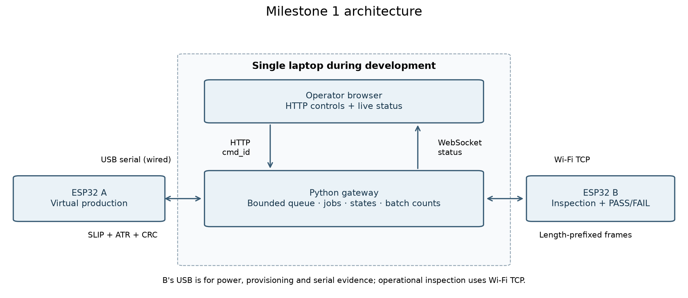
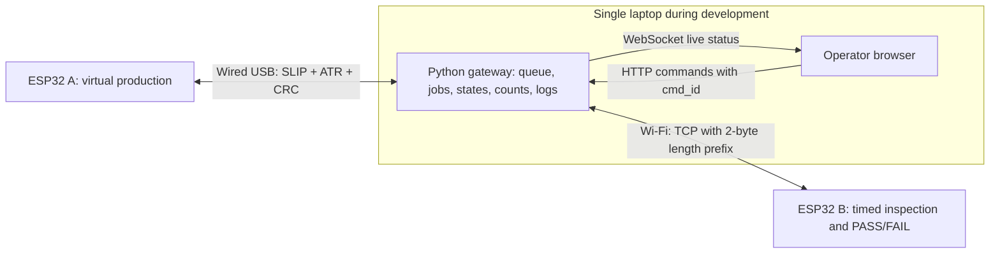
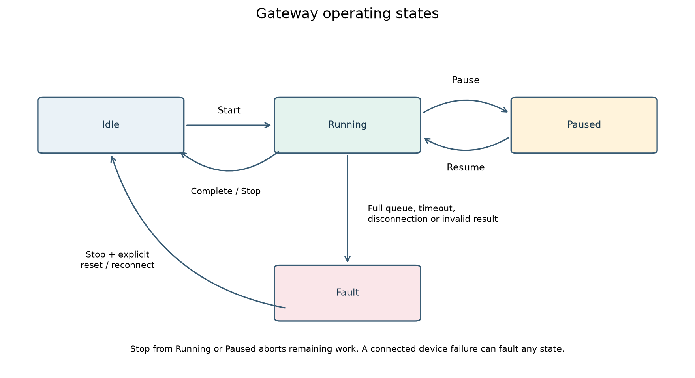
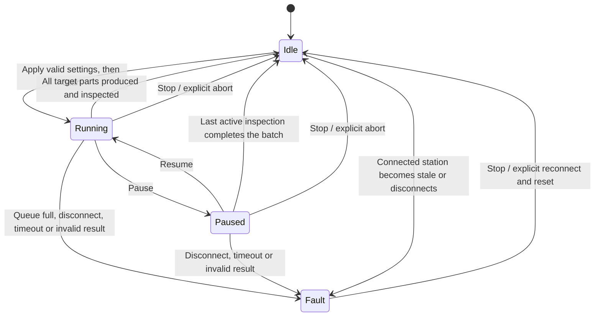
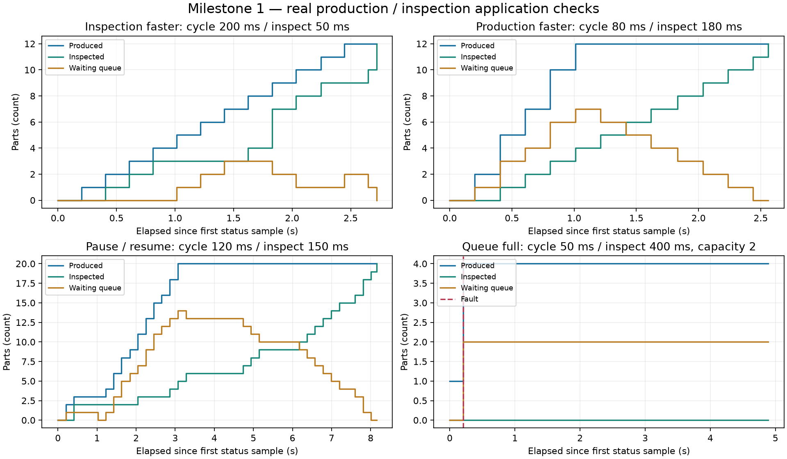

# Milestone 1 implementation and demonstration guide

Verified on real devices, 18 November 2026. This document covers Milestone 1 only.
Formal protocol benchmarking, MQTT, UDP and Modbus are outside this implementation.

## What is running

Two physical ESP32s run software production and inspection. A Python gateway
maintains the inspection queue and coordinates complete batches. A browser sends
HTTP commands and receives WebSocket status. The gateway and browser have been
tested on one Windows laptop as separate processes.

The assignment specifies a separate gateway and operator PC, making four physical
devices overall. After the one-laptop acceptance suite, a separate operator laptop
connected over the LAN and controlled batch 3319905393 to completion with 30 parts,
25 accepted and 5 rejected. The browser moves to another PC without changing
either ESP32's firmware. The six-case suite was not repeated from the second PC.

### Architecture





B's USB connection is for power, network provisioning and serial evidence. Its
production inspection jobs and verdicts travel over Wi-Fi TCP. No sensor or
mechanical apparatus is required.

Board mapping during the saved acceptance run, identified by device MAC:

| Role | Current port | Device MAC | Production communication |
|---|---|---|---|
| A, production | COM7 | f4:2d:c9:86:f5:08 | USB serial at 115200 baud |
| B, inspection | COM3 | 3c:8a:1f:b0:4b:a8 | TCP port 9000 over 2.4 GHz Wi-Fi |

After reconnection A later moved to COM3. Ports and B's DHCP address may change.
Inspect ports again after reconnecting;
never assume that COM3 always means A. Both original flash images and the images
present before today's restoration are backed up under ignored `.tools/backups/`.
Those backups are not included in the submission archive.

## Reproducing the setup

Run PowerShell in the repository root. On this PC the environment and compiler
are already installed. For a fresh checkout:

```powershell
python -m venv .venv
.\.venv\Scripts\python.exe -m pip install -r requirements.txt
.\.venv\Scripts\python.exe -m pip install -r requirements-build.txt
./scripts/build.ps1 -Station Production_ESP -Upload -Port COM7
./scripts/build.ps1 -Station Inspection_ESP -Upload -Port COM3
```

The build wrapper creates a short junction under the Windows user's `.codex`
directory. ESP-IDF rejects spaces and some long Windows paths; the junction avoids
moving the actual checkout. PlatformIO 6.2.0 / espressif32 6.12.0 selects ESP-IDF
5.5.0 and the matching compiler. Application logs on UART0 are disabled on A so
text cannot corrupt its binary protocol.

If B has not been provisioned, run:

```powershell
.\.venv\Scripts\python.exe scripts/wifi_setup.py --port COM3
```

Enter the 2.4 GHz network name and password in the local window. Credentials are
stored on B, not in source. Only B's IP/port are saved to ignored
`.tools/inspection-network.json`. Current provisioning limits are SSID 1–31 UTF-8
bytes and password 0–63 bytes. Close the serial evidence logger before provisioning
or flashing B. For incorrectly saved credentials, erase B's NVS partition using
the verified board/partition map and provision again; do not erase A.

### One-laptop operation

```powershell
.\.venv\Scripts\python.exe Gateway/server.py --bind 127.0.0.1 --port 8000
```

Open `http://127.0.0.1:8000`. Enter A's serial port and B's IP, then click
**Connect stations**. Apply target count, production time, inspection time, N, K
and queue capacity. Click **Apply settings**, then **Start**. Completion appears
only after all target parts have verdicts. A producer becoming Idle by itself
does not mean the batch is complete.

The Apply settings button is intentionally separate from Start: settings are
validated and acknowledged on both stations before production begins. Every
manufacturing HTTP command carries the same numeric `cmd_id` used on its device
link. The browser reserves an ID, then posts the identified command. Reservations
expire after five seconds and briefly prevent newer inspection jobs overtaking
the reserved ID. Duplicate HTTP commands replay the cached outcome; conflicting
reuse is rejected.

### Separate operator PC for the final demonstration

Run the gateway with `--bind 0.0.0.0`, connect both PCs to the same router, and open
`http://GATEWAY_LAN_IP:8000` from the operator PC. Allow inbound TCP 8000 on the
gateway's trusted/private network if Windows Firewall prompts. A stays plugged
into the gateway. B stays on Wi-Fi. This LAN arrangement has been designed for
the same service, but a second physical PC was unavailable for today's test.

## Batch and state behavior





- **Idle:** no production batch runs; settings can be applied.
- **Running:** A produces unique parts. The gateway admits them to its bounded
  waiting queue and dispatches one inspection at a time.
- **Paused:** A stops generating new parts. An already active inspection may
  finish, but queued jobs do not start. If production has already finished,
  Pause/Resume operates the gateway queue without trying to restart A.
- **Fault:** scheduling stops and A's heartbeat is withheld. A enters its own safe
  Fault on its retry/heartbeat deadline. Existing delayed results cannot complete
  the failed batch. Stop explicitly reconnects failed links as necessary, aborts
  remaining work, resets B and returns the system to Idle.

Queue capacity counts **waiting parts only**, excluding the one in inspection.
The chosen full-queue policy is **Fault**, permitted by the brief. The gateway
records the unadmitted part, refuses its ACK, cancels further dispatch and reports
an incomplete batch. Stop marks remaining records Aborted. It never silently
drops a part and claims successful completion.

Normal completion requires:

```text
produced = inspected = target
accepted + rejected = inspected
waiting queue empty; no active inspection
```

CSV exports preserve part IDs, job IDs, verdicts and local monotonic timestamps.
An aborted or failed batch is labelled accordingly; it is not reported complete.

## Runtime inspection rule

B computes FAIL when `(part_id + K) mod N == 0`, otherwise PASS, after its configured
inspection duration. The C implementation uses an equivalent modulo expression
that avoids unsigned overflow. N must be positive. The examiner can assign N, K
and both station times during the demonstration; they are transmitted at runtime.
No stored pass/fail pattern or gateway-generated verdict is used.

Current supported times are 10–3600000 ms; queue capacity is 1–10000. These are
validated limits, not hard-coded examiner settings. Confirm the examiner's time
range fits these limits; sub-10 ms scheduling would require a smaller task tick.

## Reliability and message specifications

See [production serial specification](production-serial-protocol.md) and
[inspection TCP specification](inspection-protocol.md) for byte layouts. Serial
uses SLIP boundaries/escaping, an 8-byte big-endian ATR header and CRC-16/CCITT-FALSE.
TCP uses a two-byte big-endian body length and bounded stream parsing. One TCP send
is not assumed to equal one receive.

Every command/job has an identifier. Configure and Stop preserve the same operator
ID across both device links; inspection jobs preserve the gateway-assigned job ID
and original part ID. Delivery, Acceptance and Completion are logged separately:

| Phase | Evidence |
|---|---|
| Delivery | Receiving application confirms arrival of the identified message |
| Acceptance | Receiver validates it and agrees to execute, or explicitly rejects it |
| Completion | State/configuration change finished, or B returns the identified PASS/FAIL |

A successful write/send is never treated as inspection completion. The firmware
remembers the latest request/result and rejects older or conflicting IDs. A retry
uses identical bytes and ID; duplicate jobs are not inspected again. Reboot IDs
separate sessions, and the gateway does not silently resume an old batch.

Heartbeats run every 500 ms. A faults after 3 s without heartbeats during active
work; the gateway rejects status older than 3.5 s. A part event has four total
transmissions, 500 ms apart. Device command retries are bounded. B detects TCP
disconnection and heartbeat loss during active inspection. The gateway accepts
only a matching current job/result; delayed results after Stop/Fault are ignored.

B sends each TCP record in one write with TCP_NODELAY and Wi-Fi power saving
disabled. This reduces avoidable buffering but does not eliminate LAN delays.
Queue capacity and inspection time must account for the actual communication path.

## Verified results and evidence

The final six live acceptance cases passed using real boards and HTTP/WebSocket
operator traffic. Counts below are from the saved final run, not invented examples:

| Case | Settings | Observed result |
|---|---|---|
| Inspection faster | 12 parts, cycle 200 ms, inspection 50 ms, N=5, K=0 | 12 inspected; 10 PASS, 2 FAIL |
| Production faster, enough room | 12 parts, cycle 80 ms, inspection 180 ms, N=3, K=1, capacity 16 | 12 inspected; 8 PASS, 4 FAIL |
| Pause / resume | 20 parts, cycle 120 ms, inspection 150 ms, N=7, K=3 | Held production/queued work; resumed; 17 PASS, 3 FAIL |
| Stop | 100-part target interrupted after at least 3 parts | Idle, explicitly Aborted, no late result counted |
| Queue full | cycle 50 ms, inspection 400 ms, capacity 2 | Fault; incomplete batch recorded; no false completion |
| Recovery and new rule | 12 parts, cycle 180 ms, inspection 70 ms, N=4, K=2, capacity 16 | Returned to normal; 9 PASS, 3 FAIL |

The browser also completed a separate three-part real batch through its buttons.
The desktop and 390-pixel-wide layouts passed checks with no JavaScript errors or
horizontal overflow. Repeated host/native tests cover protocol corruption,
duplicate execution, state transitions, stale frames, identifier replay, queue
overflow, late results and HTTP/WebSocket integration.



The plot compares application settings, not communication protocols. Samples come
from roughly 200 ms WebSocket status updates, with exact terminal completion
events added only to the derived plot. Raw CSV samples remain unchanged. Faster
production builds a queue; inspection drains it after production stops. Pause
creates a plateau. Capacity 2 deliberately reaches Fault. Even with a nominally
fast inspector, measured queue occupancy can increase because Wi-Fi/TCP replies
are delayed. Early runs demonstrated this; a finite waiting queue cannot promise
completion under arbitrary communication delays. Capacity 16 accommodates the
recorded finite recovery batch; the documented Fault policy remains active.

### Where to find the evidence

| Artifact | Path relative to repository |
|---|---|
| Six live case outcomes | `logs/milestone1-20261118/acceptance-final/results.json` |
| Raw status samples | `logs/milestone1-20261118/acceptance-final/status.csv` |
| Identified HTTP requests/responses | `logs/milestone1-20261118/acceptance-final/http.json` |
| Per-part batch CSVs and gateway events | `logs/milestone1-20261118/` |
| Framed A serial logs | `logs/milestone1-20261118/serial-*.jsonl` |
| B-side request/verdict serial evidence | `logs/milestone1-20261118/inspector-serial.jsonl` |
| TCP application byte logs | `logs/milestone1-20261118/tcp-*.jsonl` |
| Raw and annotated real packet capture | `logs/milestone1-20261118/capture-final/` |
| Browser screenshots and checks | `logs/milestone1-20261118/dashboard/` |
| Evidence consistency checks | `logs/milestone1-20261118/evidence-verification.json` |

Open `capture-final/milestone1-annotated.pcapng` in Wireshark. Packet comments explain
decoded requests and phase/result messages. For a matching job example, apply
`frame.number == 101 || frame.number == 102`: job 235 / part 199 has its inspection
request and matching PASS completion. The CSV packet index gives additional frame
numbers. The focused capture is illustrative, not a complete record of every
accepted job. B's independent serial log pairs every recorded verdict with its
request. Verification found 61 unique completed jobs with matching B-side requests.

PktMon recorded some raw 802.11 frames under an Ethernet interface descriptor.
The annotator adds the correct IEEE 802.11 interface descriptor for those frames
and comments; it preserves every captured packet byte. The original PCAPNG is
retained. Multiple PktMon observation points may show the same underlying packet;
these are not evidence of multiple job execution. An earlier broader capture and
failed acceptance run are retained as diagnostics, not claimed as passing evidence.

### Re-run the checks

```powershell
.\.venv\Scripts\python.exe -m pip install -r requirements-dev.txt
.\.venv\Scripts\python.exe -m pytest -q
.\.venv\Scripts\python.exe scripts/inspection_smoke.py --host B_IP
.\.venv\Scripts\python.exe scripts/validate_milestone1.py --serial COM7 --inspector B_IP
.\.venv\Scripts\python.exe scripts/qa_dashboard.py --serial COM7 --inspector B_IP
```

Run the inspection smoke tool before connecting the gateway (B allows one TCP
client). The acceptance and browser tests connect/reset devices themselves; they
start and abort virtual batches. Use only while no other operator is working.

For new packet evidence, run `scripts/capture_milestone1.ps1` in an administrator
PowerShell, with explicit output/signal directories. Windows denied non-admin
PktMon driver access. The helper refuses to stop another active capture, adds
filters for TCP 9000 and 8000, and removes its own filters afterward. Trigger its
`stop-capture.flag` or wait for the configured duration, then run the annotator.

## Protocol-choice rationale for Milestone 1

USB serial fits the required wired production link and is simple to frame with
SLIP/ATR/CRC. TCP fits identified inspection commands/results because the stream
is ordered and reliable, while application IDs, validation and explicit completion
still handle retries and task semantics. HTTP fits discrete browser commands;
WebSocket carries live status without repeated browser polling. These are design
reasons and Milestone 1's prescribed choices, not benchmark-based superiority
claims. The full comparison and final production protocol selection belong to
Milestone 2 and have not been implemented.

## Contribution and attribution record

| Contributor | Specific work |
|---|---|
| Sara Ahmed, original repository commits | Initial ESP-IDF production station; ATR, CRC and SLIP modules/tests; initial serial receiver and production logic |
| Student — fill in your name | Supplied/connected boards, selected the network and PC arrangement, provided project requirements; must review implementation, perform the live demonstration and explain all design decisions |
| Codex-assisted implementation in this working copy | Bidirectional A control/retries, B inspection firmware, gateway queue/state/batch integration, browser HTTP/WebSocket interface, tests, capture annotation and documentation |

Replace the student name and add only work you actually performed. Do not invent
team members or percentages.

## Live demonstration and oral checklist

1. Explain device roles and distinguish one-laptop development from the requested
   separate operator/gateway arrangement.
2. Let the examiner choose target, cycle, inspection duration, N and K. Apply them
   through the browser and show the identified configuration acknowledgements.
3. Run a full batch; trace one part through serial, queue, TCP request and B verdict.
4. Show accepted + rejected = target only after every inspection completes.
5. Demonstrate Pause/Resume, then Stop in another batch and distinguish Aborted.
6. Run production faster than inspection with capacity 2 to exercise Fault. Use
   Stop, apply fresh settings, and run a recovery batch.
7. Explain the difference between transport delivery, application acceptance and
   task completion; show separate events with the same identifier.
8. Explain retries, duplicate suppression, stale data, disconnection and safe state.
9. Show real captures and logs; explain that formal benchmarks are deferred.

Human oral explanation, student identity, and instructor acceptance of any
hardware/team exception remain classroom requirements, not something automated
tests can complete.
